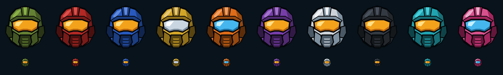

# herdr-theme-halo

Tema para [Herdr](https://herdr.dev) inspirado en Halo: fondo del Master Chief y Cortana, interfaz tipo HUD, sonidos propios y **un casco de color aleatorio para cada agente**.

> Proyecto de fans, no oficial y sin fines comerciales. Halo es una marca de Microsoft; este repositorio no está afiliado ni respaldado por Microsoft.
>
> El fondo `backgrounds/halo-infinite.jpg` es arte oficial de **Halo Infinite** (343 Industries), tomado de [TheXboxHub](https://www.thexboxhub.com/wp-content/uploads/2021/12/image-9.jpeg). El fondo del anillo (`halo.jpg`), los cascos y los sonidos son originales.
>
> Halo Infinite © Microsoft Corporation. herdr-theme-halo was created under Microsoft's [Game Content Usage Rules](https://www.xbox.com/en-US/developers/rules) using assets from Halo Infinite, and it is not endorsed by or affiliated with Microsoft.



## Qué incluye

| Carpeta | Contenido |
|---|---|
| `layouts/` | El layout `halo` y su vista previa |
| `themes/` | Colores (cian HUD, verde armadura, dorado visor) |
| `backgrounds/` | Fondo de Halo Infinite (activo) y fondo alternativo con el anillo |
| `icons/halo/` | 10 cascos: verde, rojo, azul, dorado, naranja, morado, blanco, negro, cian y rosa |
| `sounds/` | Sonido de "agente terminado" y de "agente te necesita" |
| `mods/halo-agents/` | La lista de agentes, con cascos |
| `mods/halo-spaces/` | El panel Spaces como árbol (spaces, tabs y panes), con cascos |

## Requisitos

- Herdr app 0.1.17 o similar (con esa versión se hizo).
- Windows para usar `install.ps1`. En macOS o Linux, instala a mano.

## Instalación (Windows)

Abre Herdr al menos una vez. Luego, en PowerShell:

```powershell
git clone https://github.com/AlexanderPV11/herdr-theme-halo.git
cd herdr-theme-halo
powershell -ExecutionPolicy Bypass -File .\install.ps1
```

Opciones: `-SinSonidos` conserva tus sonidos y `-NoActivar` instala sin cambiar de layout.

El instalador:

- copia los archivos a `~/.config/herdr-app` (o a `HERDR_APP_HOME`);
- si alguno ya existe, lo mueve antes a `backup-halo-<fecha>`;
- guarda una copia de `settings.json` y le agrega los dos sonidos;
- activa el layout `halo`.

## Instalación manual (macOS / Linux)

1. Copia el **contenido** de `layouts/`, `themes/`, `backgrounds/`, `icons/`, `sounds/` y `mods/` dentro de las carpetas del mismo nombre en `~/.config/herdr-app/`.
2. Agrega a `~/.config/herdr-app/settings.json` (junto a lo que ya tengas):

   ```json
   "sounds": { "enabled": true, "done": "sounds/halo-done.mp3", "blocked": "sounds/halo-blocked.mp3" }
   ```

3. Activa el layout:

   ```sh
   herdr-app do layout.switch --name halo
   ```

## Cómo funcionan los cascos

Cada agente recibe un color al azar, sin repetirse mientras queden libres, y lo conserva mientras su terminal siga abierta. Aparecen en el árbol de Spaces y en la lista de agentes, solo con el layout `halo`; las pestañas y cabeceras mantienen el icono del programa. La lógica está en `halo.js`, igual en los dos mods.

## Volver atrás

```sh
herdr-app do layout.switch --name main
```

Los sonidos se aplican a todos los layouts: para quitarlos, borra `done` y `blocked` de `settings.json`.

## Notas

- Para usar el anillo, cambia en `layouts/halo.json` la imagen a `backgrounds/halo.jpg`. Para poner la tuya, cópiala en `backgrounds/` (idealmente 2560×1440 o más) y apunta ahí.
- `halo-agents` y `halo-spaces` son copias modificadas de los mods `agents` y `spaces` de Herdr: no reciben las mejoras que Herdr haga en los originales. No se incluye licencia; revisa la de Herdr antes de redistribuirlos.
